<div align="center">

<a href="https://codexsploitx.github.io/uniora/"></a>

# UNIORA

**Universal Organization & Authorization**

Organizaciones, equipos, roles, permisos y feature flags — para cualquier proveedor de autenticación, sobre tu propia base de datos.

[](https://github.com/CodexSploitx/uniora)

[](https://www.npmjs.com/org/uniora)


[English](README.md) · [Sitio web](https://codexsploitx.github.io/uniora/) · [Documentación](guides/README.md)

</div>

---

Tu proveedor de autenticación responde **"¿quién es este usuario?"**. No debería tener que responder también **"¿a qué organización pertenece, y qué puede hacer ahí?"** — es un problema distinto, uno que conviene mantener bajo control propio, sin importar qué proveedor de autenticación se elija hoy o al que se migre en el futuro.

**UNIORA es la capa que se coloca entre ambas preguntas.** No es un proveedor de autenticación — se conecta al que ya utilizas (Supabase, Clerk, Auth0, Better Auth) — y no es un SaaS: las organizaciones, membresías, roles, permisos y audit logs que administra viven en **tu propia base de datos**, no en la nuestra.

```text
Auth Provider                        UNIORA
     │                                  │
"¿Quién eres?"          "¿En qué organización estás? ¿Qué puedes hacer?
                         ¿Qué tiene habilitado tu organización?"
     │                                  │
     └────────────────┬─────────────────┘
                       ▼
                 ALLOW / DENY
```

## Por qué

- **Provider-agnostic.** Sustituye Supabase por Clerk, o añade Auth0 en paralelo, sin reescribir la lógica de autorización. `IdentityLinkRepository` incluso permite que un usuario migre de proveedor sin perder su organización, roles ni permisos.
- **Tu base de datos, tus reglas.** Ningún servicio central de UNIORA guarda tus datos. Todo vive en Postgres (o SQLite, para desarrollo local y despliegues de un solo nodo), bajo un schema dedicado `uniora.*` (tablas `uniora_*` en SQLite) que no colisiona con las tablas de tu propia app.
- **Deny-by-default.** El `AuthorizationEngine` nunca otorga un acceso que no pueda justificar con confianza — permiso desconocido, membresía inexistente, organización incorrecta: siempre `DENY`, nunca un fallback silencioso a `ALLOW`.
- **Las organizaciones no pueden quedar huérfanas.** Toda organización nace con un Owner protegido, y `MembershipRepository` rechaza quitarle el role Owner o borrar una membership si es la última que lo tiene — reforzado con una constraint real de base de datos, no solo con código de aplicación.
- **Organizaciones *y* entitlements.** Los permisos responden "qué puede hacer este usuario"; las features responden "qué tiene desbloqueado esta organización". Son dos preguntas distintas, modeladas por separado, para que no tengas que simular una con la otra.
- **Core framework-independent.** `@uniora/core` no depende de Next.js, Express, ni de ningún driver de base de datos específico — los adapters se conectan alrededor.

## Dos formas de ejecutar UNIORA

El mismo motor, las mismas reglas y el mismo modelo de datos. Elige cómo llega a tu código:

| | Biblioteca embebida | Servidor independiente |
| --- | --- | --- |
| **Se ejecuta** | Dentro del proceso de tu backend | Como un servicio aparte que tú operas |
| **Se invoca con** | `uniora.can()` | HTTPS y una API key (`POST /v1/check`), o el `@uniora/client` tipado |
| **Salto de red** | Ninguno | Una solicitud por decisión |
| **Lenguajes** | TypeScript y Node.js | Cualquier lenguaje por REST ([OpenAPI](guides/openapi.json)) |
| **Datos** | Tu base de datos, en un esquema `uniora.*` dedicado | Su propia base de datos dedicada |
| **Control de acceso** | El código de tu aplicación | API clients con scopes y listas de organizaciones |
| **Empezar** | `npm install @uniora/core` | `npx uniora server start` |
| **Guía** | [Primeros pasos](guides/getting-started.md) | [El servidor](guides/server.md) |

No existe una nube de UNIORA. En ambos modos lo ejecutas tú y los datos son tuyos.

## Qué incluye

- **Organizaciones, miembros, roles y permisos.** Roles personalizados por organización, un catálogo de permisos con grupos e implicaciones, un Owner protegido, miembros bloqueados y suspendidos.
- **Equipos.** Una jerarquía con responsabilidades. Un equipo da contexto, nunca acceso ([guía](guides/teams.md)).
- **Políticas.** Reglas condicionales sobre los permisos: atributos del recurso, alcance y jerarquía de equipos, tiempo y contexto de la solicitud, y step-up (MFA reciente). Simula antes de publicar ([guía](guides/policies.md)).
- **Features y cuotas.** Qué ha desbloqueado cada organización y cuántos asientos o reportes puede usar ([guía](guides/entitlements.md)).
- **Invitaciones.** Enlaces de un solo uso, envío por correo con reintentos, reenvío y revocación ([guía](guides/invitations.md)).
- **Administración delegada.** Permite que los líderes inviten y asignen roles sin escalada de privilegios ([guía](guides/access-admin.md)).
- **Log de auditoría.** Solo-añadir y encadenado por hash, con verificación de integridad ([guía](guides/audit-log.md)).
- **Webhooks y outbox.** Eventos escritos en la misma transacción que el cambio y entregados después, firmados y con reintentos ([outbox](guides/outbox.md)).
- **Administradores de plataforma y support grants.** El poder del personal propio queda fuera de cualquier organización, y el acceso temporal y auditado a los datos de un cliente es explícito ([plataforma](guides/platform.md), [support grants](guides/support-grants.md)).
- **Row-level security en PostgreSQL.** Funciones SQL que dan a tus propias tablas las mismas respuestas que el motor ([guía](guides/rls.md)).
- **Herramientas.** Un CLI con ledger de migraciones, un cliente tipado y Studio, una interfaz de administración local. Medido con 5.000.000 de membresías ([rendimiento](guides/performance.md)).

## UNIORA Studio

Una interfaz de administración local-first sobre tu propia base de datos. Se ejecuta con `npx uniora studio`. Solo escucha en `127.0.0.1`, se desbloquea con un token aleatorio por lanzamiento y no envía datos a ningún lado. Cada cambio que hace queda auditado, y `--read-only` lo convierte en un visor seguro. Las capturas muestran una base de datos de demostración.

<p align="center"><a href="assets/readme/es/overview.webp">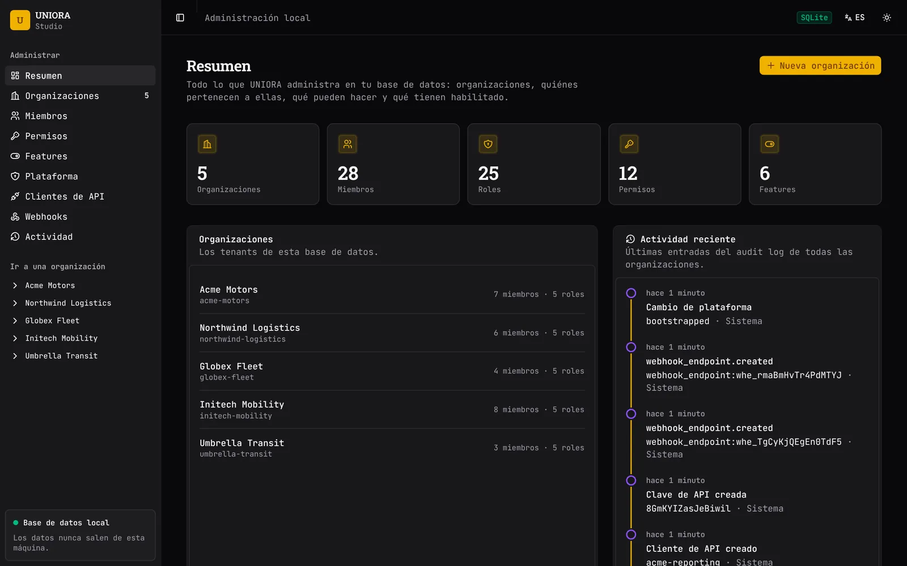</a></p>

<table>
<tr>
<td width="50%"><a href="assets/readme/es/members.webp">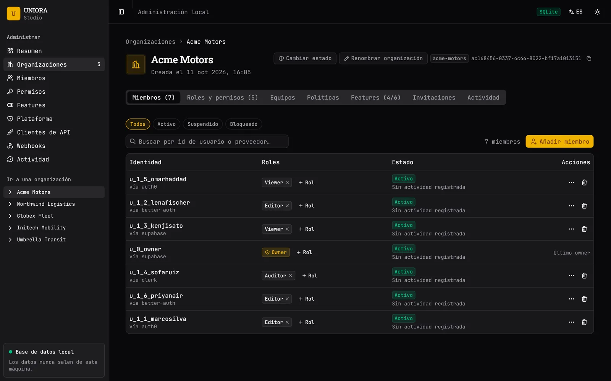</a><br><sub><b>Miembros</b>. Identidades de cualquier proveedor con sus roles. El Owner protegido no puede eliminarse.</sub></td>
<td width="50%"><a href="assets/readme/es/roles.webp">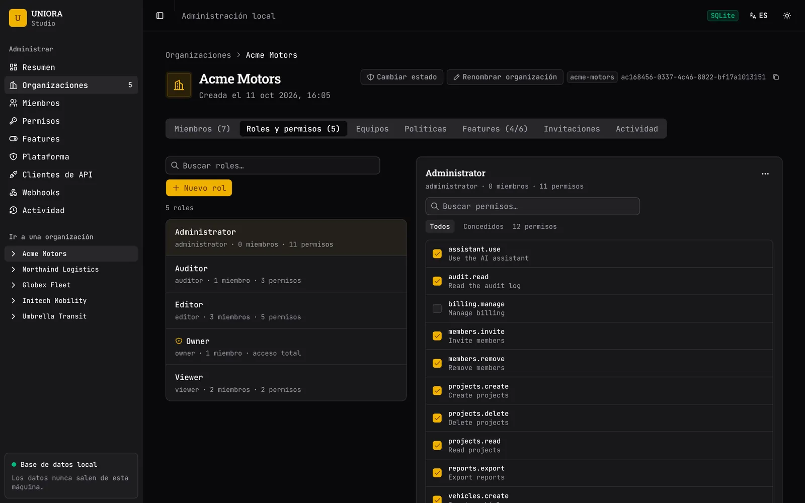</a><br><sub><b>Roles y permisos</b>. Una lista de permisos por rol, por organización.</sub></td>
</tr>
<tr>
<td width="50%"><a href="assets/readme/es/teams.webp">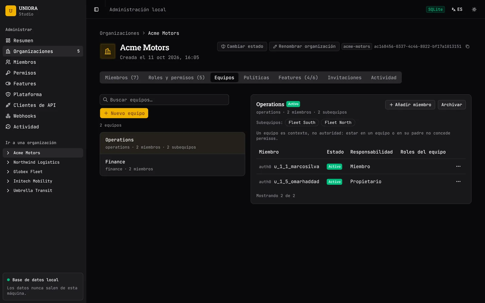</a><br><sub><b>Equipos</b>. Una jerarquía con responsabilidades. Un equipo es contexto, no autoridad.</sub></td>
<td width="50%"><a href="assets/readme/es/policies.webp">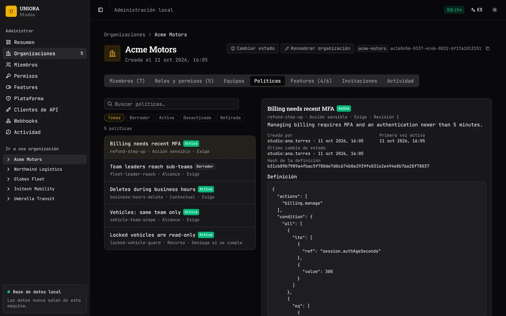</a><br><sub><b>Políticas</b>. Reglas condicionales con historial de revisiones. Solo lectura en Studio.</sub></td>
</tr>
<tr>
<td width="50%"><a href="assets/readme/es/invitations.webp">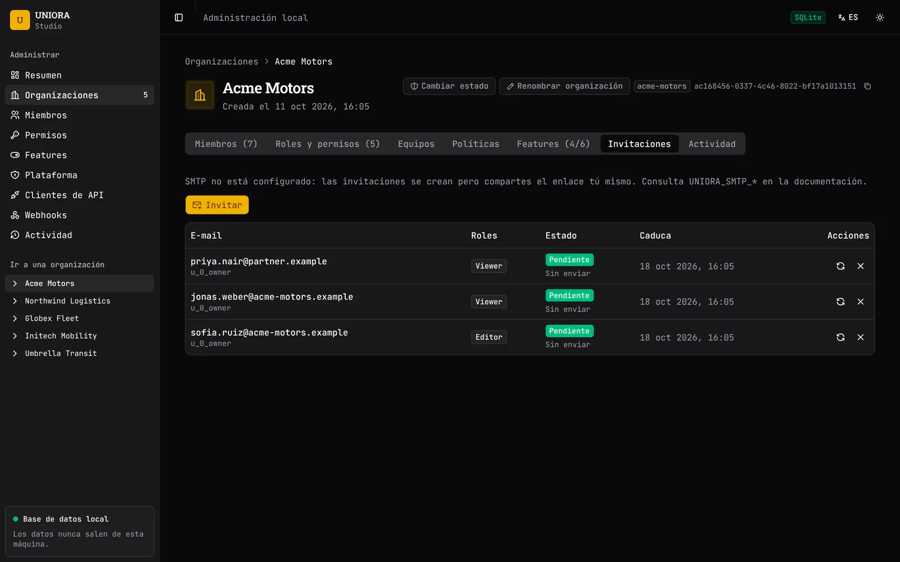</a><br><sub><b>Invitaciones</b>. Invita, reenvía y revoca. Los enlaces son de un solo uso.</sub></td>
<td width="50%"><a href="assets/readme/es/features.webp">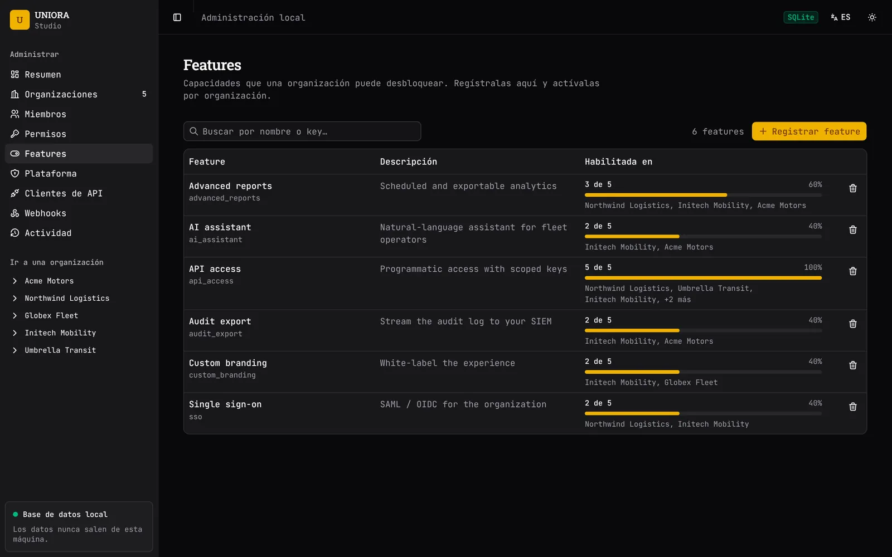</a><br><sub><b>Features</b>. Qué organizaciones tienen desbloqueada cada feature.</sub></td>
</tr>
<tr>
<td width="50%"><a href="assets/readme/es/api-clients.webp">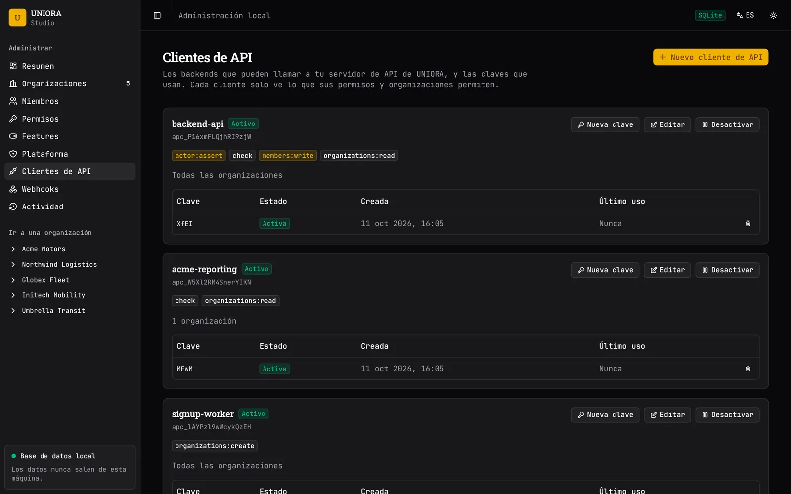</a><br><sub><b>Clientes de API</b>. Clientes y claves con scopes para el servidor independiente. La clave se muestra una vez.</sub></td>
<td width="50%"><a href="assets/readme/es/webhooks.webp">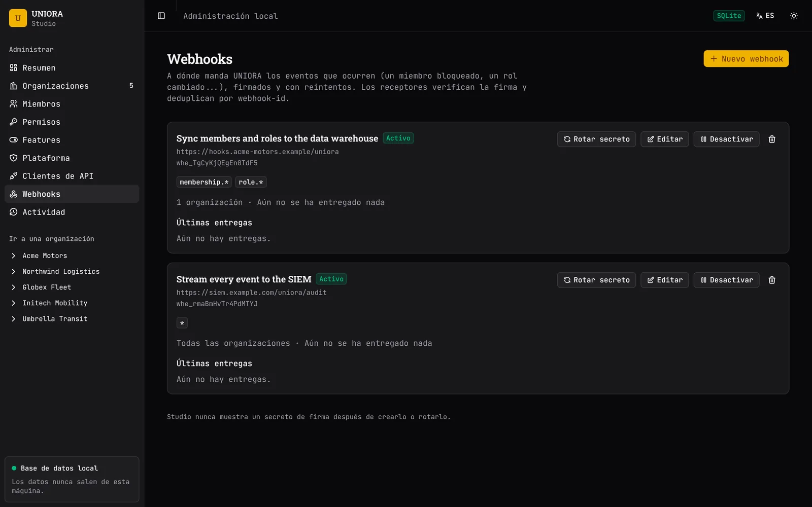</a><br><sub><b>Webhooks</b>. Eventos firmados con reintentos y rotación del secreto.</sub></td>
</tr>
<tr>
<td width="50%"><a href="assets/readme/es/platform.webp">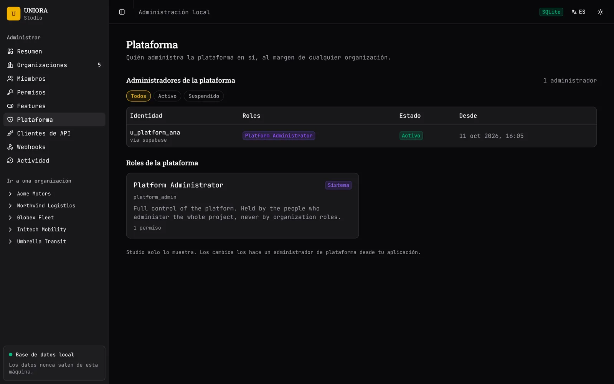</a><br><sub><b>Plataforma</b>. Quién administra la plataforma, aparte de cualquier organización. Solo lectura en Studio.</sub></td>
<td width="50%"><a href="assets/readme/es/activity.webp">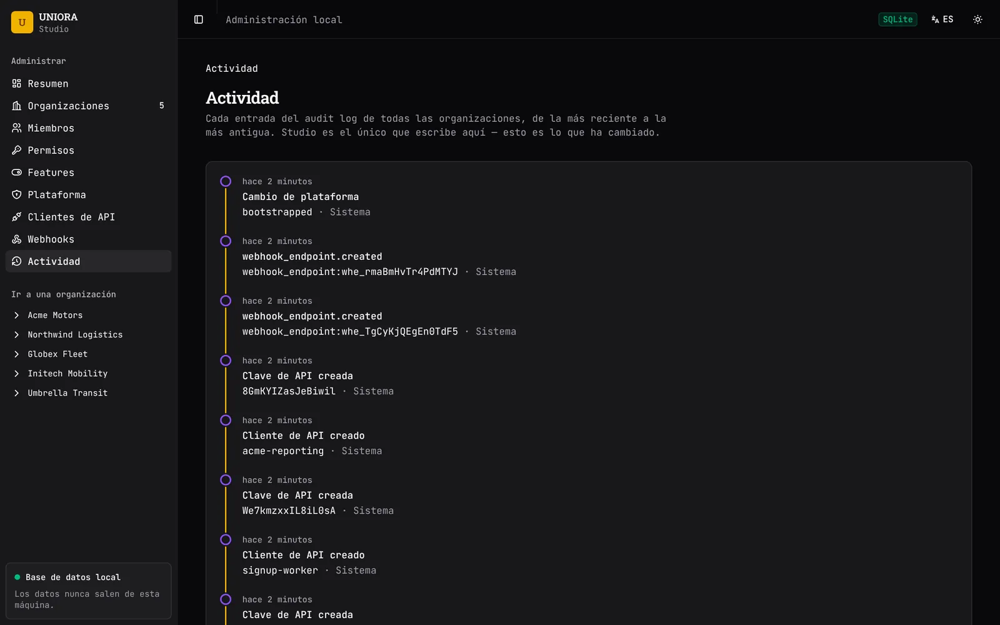</a><br><sub><b>Log de auditoría</b>. Cada cambio de todas las organizaciones, el más reciente primero.</sub></td>
</tr>
</table>

<details>
<summary>Más pantallas</summary>

<p><b>Organizaciones</b></p>
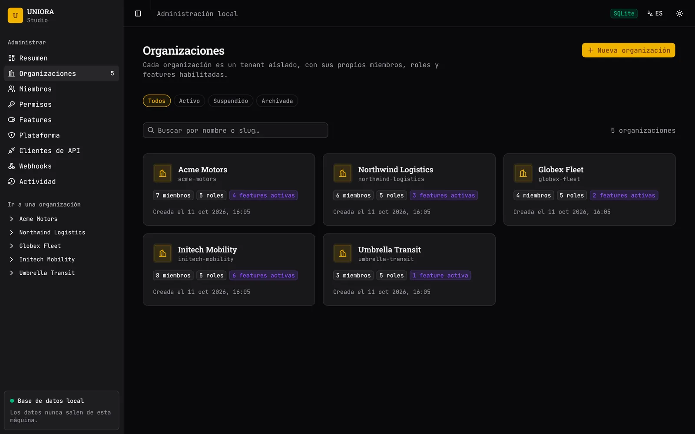

<p><b>Catálogo de permisos</b>. La lista global de acciones que tu app puede verificar, y cuántos roles tiene cada una.</p>
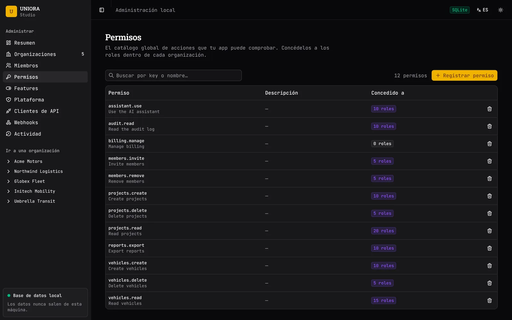

<p><b>Features por organización</b>. Activa y desactiva features para una organización.</p>
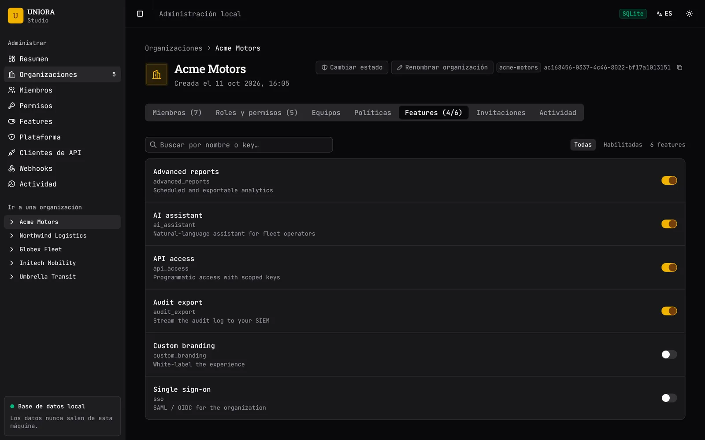

</details>

## Vistazo rápido

```ts
import { createAuthorizationEngine, createMemoryStorage } from "@uniora/core";
// en producción, sustituye createMemoryStorage() por @uniora/postgres (o @uniora/sqlite)

const storage = createMemoryStorage();
const uniora = createAuthorizationEngine(storage);

const puedeBorrarVehiculo = await uniora.can({
  identity: { provider: "supabase", subject: userId },
  organizationId: orgId,
  permission: "vehicles.delete",
});

// Comprobación combinada de permiso + feature habilitada en la organización
const puedeUsarIA = await uniora.access.check({
  identity: { provider: "supabase", subject: userId },
  organizationId: orgId,
  permission: "assistant.use",
  feature: "ai_assistant",
});
```

Toda organización nace con exactamente un **Owner** protegido — creado de forma atómica junto con la organización, nunca como algo posterior:

```ts
import { createOrganizationWithOwner } from "@uniora/core";

const { organization, membership } = await createOrganizationWithOwner(storage, {
  organizationId: orgId,
  organizationName: "Acme Motors",
  // organizationSlug es opcional — se deriva del nombre si se omite
  // ("Acme Motors" -> "acme-motors"), y se valida y garantiza único en ambos casos.
  ownerRoleId: crypto.randomUUID(),
  membershipId: crypto.randomUUID(),
  ownerIdentity: { provider: "supabase", subject: userId },
});
// El owner de esa membership pasa cualquier chequeo de uniora.can(...) en esta
// organización, sin importar permissionKeys — revisa la documentación de
// @uniora/core para entender por qué.
```

Resolver la `identity` a partir de una sesión real es una sola llamada al adapter correspondiente:

```ts
import { resolveIdentity } from "@uniora/supabase"; // o @uniora/clerk, @uniora/auth0, @uniora/better-auth

const identity = await resolveIdentity(supabaseClient, accessToken); // Identity | null
```

Los adapters de identidad solo responden "¿quién es este subject?" — nunca "¿qué puede hacer?". Esa decisión es siempre del `AuthorizationEngine`.

El servidor calcula un `AuthorizationSnapshot` acotado; el cliente solo lo lee — `@uniora/react` nunca habla con tu base de datos:

```ts
// servidor (p. ej. un Server Component, una API route)
import { computeAuthorizationSnapshot } from "@uniora/core";

const snapshot = await computeAuthorizationSnapshot(engine, storage.features, {
  identity,
  organizationId,
  permissions: ["vehicles.create"],
  features: ["advanced_reports"],
});
```

```tsx
// cliente
import { UnioraProvider, Can, Feature } from "@uniora/react";

<UnioraProvider snapshot={snapshot}>
  <Can permission="vehicles.create">
    <CreateVehicleButton />
  </Can>
  <Feature feature="advanced_reports">
    <AdvancedReportsPanel />
  </Feature>
</UnioraProvider>
```

`<Can>`/`<Feature>`/`useCan`/`useFeature` son solo UX y deliberadamente headless (sin ningún sistema de diseño incluido) — ocultar un botón nunca sustituye a que el servidor autorice de forma independiente la operación real. Ver `apps/playground` para un ejemplo funcional completo construido con shadcn/ui + ReUI.

Específicamente para Next.js, `@uniora/next` conecta las piezas de arriba con los propios patrones del App Router — sin dependencia dura del paquete `next` en sí, solo `react.cache()` para memoización por request y las APIs estándar `Response`/`Request`:

```ts
// servidor — Server Action o Route Handler
import { assertCan, authorizeRoute } from "@uniora/next";

// lanza AuthorizationDeniedError — para un Server Action
await assertCan(engine, { identity, organizationId, permission: "vehicles.delete" });

// devuelve un Response | null listo para retornar — para un Route Handler
const denied = await authorizeRoute(engine, { identity, organizationId, permission: "vehicles.delete" });
if (denied) return denied;
```

Para Express, `@uniora/express` es un middleware de ruta — también sin dependencia del paquete `express` en sí. Responde `401` cuando no se sabe quién llama y `403` cuando el motor deniega, y cualquier error (tuyo, del motor o de la base de datos) va a `next(err)`: un fallo nunca deja pasar una request. No depende del manejo de errores async de Express 5, así que sirve también en Express 4.

```ts
import { requirePermission, requireFeature } from "@uniora/express";

app.delete(
  "/orgs/:orgId/vehicles/:id",
  requirePermission(engine, "vehicles.delete", {
    // identity: lo que resolvió tu middleware de auth (con @uniora/supabase, @uniora/clerk, ...)
    resolve: (req) => req.identity && { identity: req.identity, organizationId: req.params.orgId },
  }),
  deleteVehicle,
);
// requireFeature(engine, "ai_assistant", { resolve }) comprueba lo que la organización tiene habilitado;
// authorize(engine, { permission, feature, resolve }) comprueba ambos.
```

## Documentación

La documentación completa está en [`guides/`](guides/README.md) (en inglés):
[Getting started](guides/getting-started.md) · [Concepts](guides/concepts.md) · [Core reference](guides/core-reference.md) · [Storage](guides/storage.md) · [Identity adapters](guides/identity-adapters.md) · [Express, Next.js y React](guides/frameworks.md) · [Invitations](guides/invitations.md) · [Audit log](guides/audit-log.md) · [CLI, Studio y configuración](guides/cli-and-studio.md) · [Errors](guides/errors.md) · [Hardening](guides/hardening.md).

## Paquetes

| Paquete | Qué hace |
| --- | --- |
| [`@uniora/core`](packages/core) | Modelo de dominio framework-independent: Organizations (con un role Owner protegido, creado de forma atómica), Custom Roles, Permissions, Features, Audit Logs, Identity Linking cross-provider, Invitations (tokens de un solo uso, motor de entrega con reintentos), y el `AuthorizationEngine` deny-by-default. |
| [`@uniora/postgres`](packages/database/postgres) | Adapter de storage para PostgreSQL (schema dedicado `uniora.*`) + migraciones. |
| [`@uniora/sqlite`](packages/database/sqlite) | Adapter de storage para SQLite sobre [`better-sqlite3`](https://github.com/WiseLibs/better-sqlite3) (tablas `uniora_*`) + migraciones. |
| [`@uniora/mailer-smtp`](packages/mailer-smtp) | Sender SMTP para invitaciones: se configura con `UNIORA_SMTP_*` en `.env`, con plantillas de correo profesionales y multilingües. |
| [`@uniora/supabase`](packages/adapters/supabase) | Adapter de identidad para Supabase Auth. |
| [`@uniora/clerk`](packages/adapters/clerk) | Adapter de identidad para Clerk. |
| [`@uniora/better-auth`](packages/adapters/better-auth) | Adapter de identidad para Better Auth. |
| [`@uniora/auth0`](packages/adapters/auth0) | Adapter de identidad para Auth0. |
| [`@uniora/react`](packages/react) | Helpers headless de React (`<Can>`, `<Feature>`, `useCan`, `useFeature`) sobre un `AuthorizationSnapshot` calculado en servidor. |
| [`@uniora/next`](packages/next) | Pegamento de Next.js: memoización por request (`react.cache()`) más los guards `assertCan`/`assertAccess`/`authorizeRoute` para Server Actions y Route Handlers, y los helpers de rutas de invitación. |
| [`@uniora/express`](packages/express) | Middleware de Express (`requirePermission`, `requireFeature`, `authorize`): guards de ruta deny-by-default que responden 401/403 y fallan cerrado ante cualquier error, más las rutas de vista previa y aceptación de invitaciones. |
| [`@uniora/server`](packages/server) | UNIORA como API HTTP propia y autoalojada: claves de API con scopes y lista de organizaciones, decisiones, cambios delegados en nombre de un usuario final, alta de organizaciones, invitaciones; documentada endpoint por endpoint ([guía, en inglés](guides/server.md)). |
| [`@uniora/client`](packages/client) | El cliente tipado de esa API para tu backend, con reintentos y un `AuthorizationEngine` remoto para los guards de Express y Next. |
| [`@uniora/cli`](packages/cli) | `npx uniora init / check / migrate / doctor / studio` — con ledger de migraciones, salida `--json` y códigos de salida aptos para CI. |
| [`@uniora/studio`](apps/studio) | UNIORA Studio: una interfaz de administración local (Next.js + shadcn/ui + ReUI) para explorar y administrar organizaciones, miembros, roles, permisos, features y el audit log. Se abre con `npx uniora studio`. |

### Invitar personas a una organización

UNIORA es dueño del flujo de invitaciones — token de un solo uso (solo se guarda su SHA-256), rol(es), expiración, reenviar/revocar, aceptar, límites de frecuencia y rastro de auditoría — y delega la entrega a un `InvitationSender` conectable. Usa `@uniora/mailer-smtp` para un sender SMTP listo, con plantillas profesionales, multilingües (en/es/pt/fr/de/it) y compatibles con modo oscuro, o escribe el tuyo para Resend, SES, una cola...

```ts
import { createInvitationService } from "@uniora/core";
import { createSmtpInvitationSenderFromEnv } from "@uniora/mailer-smtp";

const invitations = createInvitationService({
  storage,
  acceptUrl: (token) => `https://app.example.com/invite/${token}`,
  sender: createSmtpInvitationSenderFromEnv(), // lee UNIORA_SMTP_* del .env y falla al arrancar si falta algo
});

// Autoriza antes (p. ej. engine.can(... "members.invite")) — el servicio no lo hace.
const { acceptUrl, delivery } = await invitations.invite({
  organizationId, email: "ana@example.com", roleIds: [editorRoleId], invitedBy: identity, locale: "es",
});

// En tu página /invite/[token], después de que la persona inicie sesión:
const { membership } = await invitations.accept({ token, identity, verifiedEmail: user.email }); // solo un e-mail verificado por el proveedor
```

La entrega nunca hace fallar la petición: los errores SMTP transitorios se reintentan con backoff y jitter, cada intento tiene su timeout, el resultado queda registrado en la invitación y una fallida se puede `resend` (emite un enlace nuevo e invalida el anterior). El role Owner no se puede otorgar por invitación. Sin sender la invitación igual se crea y se devuelve el enlace para que lo entregues tú. `resend` y `revoke` reciben `{ organizationId, invitationId, actor }` y tratan la invitación de otra organización como inexistente; `accept` exige un email verificado por el proveedor (`toVerifiedEmail` en cada adaptador de identidad).

Las dos páginas públicas del flujo vienen listas. En Express (`@uniora/express`):

```ts
import { acceptInvitation, invitationPreview } from "@uniora/express";

app.get("/invite/:token", invitationPreview(invitations, { token: (req) => req.params.token }));
app.post("/invite/:token/accept", acceptInvitation(invitations, {
  token: (req) => req.params.token,
  resolve: async (req) => req.user && { identity: req.identity, verifiedEmail: req.user.verifiedEmail },
}));
```

En Next.js, `previewInvitationRoute(invitations, token)` y `acceptInvitationRoute(invitations, { token, caller })` (`@uniora/next`) devuelven un `Response` para tus Route Handlers. Cualquier fallo al aceptar responde el mismo `400 invalid_invitation` genérico, así que el endpoint no sirve para averiguar qué enlaces o e-mails existen. Studio tiene una pestaña **Invitaciones** para invitar, reenviar y revocar (define `UNIORA_INVITE_URL`), y `npx uniora doctor` valida tus `UNIORA_SMTP_*`.

La propiedad tiene dos helpers atómicos y auditados: `transferOwnership(storage, { organizationId, fromMembershipId, toMembershipId, actor })` y `leaveOrganization(storage, { organizationId, identity })` (el último Owner nunca puede salir). Ninguno autoriza a quien llama: protégelos tú.

**Hardening:** el audit log es solo-anexar y está encadenado con hashes (`auditLogs.verifyIntegrity()`, `npx uniora doctor`), y el motor puede informar cada decisión con `onDecision`. Consulta [guides/hardening.md](guides/hardening.md) para los controles que viven fuera del código (roles de base de datos, anclar la cabeza del audit log, ajustes de publicación).

```bash
# .env
UNIORA_SMTP_HOST=smtp.example.com
UNIORA_SMTP_PORT=587
UNIORA_SMTP_USER=...
UNIORA_SMTP_PASS=...
UNIORA_SMTP_FROM="Acme <no-reply@acme.com>"
```

### Usar SQLite

`@uniora/sqlite` implementa el mismo `UnioraStorage` que `@uniora/postgres` — y se le exige la misma suite de comportamiento, incluidas las regresiones de concurrencia y seguridad — para desarrollo local, tests y apps pequeñas autoalojadas o de un solo nodo.

```bash
npm install @uniora/sqlite better-sqlite3
npm install -D @types/better-sqlite3   # solo TypeScript
```

```ts
import Database from "better-sqlite3";
import { applyMigrations, createSqliteStorage } from "@uniora/sqlite";

const db = new Database("app.db");
db.pragma("journal_mode = WAL"); // recomendado si varios procesos comparten el archivo
applyMigrations(db);             // síncrona e idempotente — segura en cada arranque
const storage = createSqliteStorage(db);
```

Conviene saber:

- **Usa una conexión por proceso.** El adapter serializa cada operación sobre ella y ejecuta cada operación de varias sentencias (guarda del último Owner, vinculación de identidades, ...) en una transacción `begin immediate`: otro proceso sobre el mismo archivo espera su turno en lugar de competir. Las foreign keys se activan — y se verifican — en la conexión.
- Los timestamps son texto ISO-8601 con precisión de milisegundos, y las búsquedas tipo `ILIKE` pliegan mayúsculas Unicode, igual que el adapter de Postgres.
- La CLI y Studio también funcionan con SQLite — ver [CLI](#cli).

## Instalación y desarrollo local

Requiere Node.js, [pnpm](https://pnpm.io) y Docker (para Postgres local).

```bash
git clone https://github.com/CodexSploitx/uniora.git
cd uniora
pnpm install

docker compose up -d        # Postgres en localhost:55432
cp .env.example .env        # ajusta DATABASE_URL si cambiaste los valores por defecto

pnpm build       # build de todos los paquetes
pnpm typecheck   # typecheck de todo el monorepo
pnpm test        # todos los tests, incluyendo integración real contra Postgres y SQLite
```

## CLI

Instálalo en tu proyecto (deja el comando `uniora` disponible para `npx`):

```bash
npm install --save-dev @uniora/cli
```

o ejecútalo una vez sin instalar nada: `npx @uniora/cli init`. (Usa el nombre con scope en esa forma puntual — un `npx uniora` a secas, fuera de un proyecto que ya tenga `@uniora/cli` instalado, resolvería a *otro* paquete de npm.)

```bash
npx uniora init      # crea uniora.config.mjs y .env.example (--provider sqlite para un proyecto SQLite)
npx uniora check     # valida la config y la conexión a la base de datos
npx uniora migrate   # aplica las migraciones pendientes de uniora.* (registradas en un ledger, aditivas, nunca destructivas)
npx uniora doctor    # diagnóstico más profundo: Node, .gitignore, config, DB, versión del motor, migraciones, owners, Studio
npx uniora studio    # abre UNIORA Studio en local (--read-only, --port N, --no-open)
```

Pensado para correr también en CI, no solo en tu equipo:

```bash
npx uniora migrate --status --env production   # sale con 1 si hay migraciones pendientes o editadas tras aplicarse
npx uniora migrate --dry-run                   # ¿qué haría `migrate`? no toca nada
npx uniora doctor --json | jq '.checks[] | select(.severity != "ok")'
```

**PostgreSQL o SQLite.** `database.provider` en `uniora.config.mjs` elige el motor, y `database.url` es una connection string para `"postgresql"` o `sqlite:<ruta>` para `"sqlite"` (relativa a tu proyecto, o absoluta):

```js
export default defineConfig({
  database: { provider: "sqlite", url: process.env.DATABASE_URL }, // DATABASE_URL=sqlite:./uniora.db
});
```

Con SQLite, los comandos de solo lectura (`check`, `doctor`, `migrate --status`/`--dry-run`) abren el archivo en solo lectura y nunca lo crean ni lo alteran — un archivo ausente se reporta, no se inventa; solo `migrate` lo crea (y lo pasa a WAL). `init --provider sqlite` además añade `uniora.db*` al `.gitignore`, porque el archivo contiene tus datos de autorización. Studio muestra en qué motor está y funciona igual, incluido `--read-only` (entonces la propia conexión SQLite es de solo lectura).

Todos los comandos aceptan `--config <archivo>`, `--env <nombre>` (carga `.env.<nombre>` — y solo ese, sin caer en silencio a tu `.env` de desarrollo) y `--json` (un único objeto JSON en stdout, que nunca contiene tu connection string). Códigos de salida: `0` ok · `1` algo falló · `2` uso incorrecto. `npx uniora <comando> --help` para más detalle.

**UNIORA Studio** es una interfaz de administración local sobre tu propia base de datos — un editor de roles y permisos, miembros, features por organización, un catálogo global de permisos/features y un registro de actividad de solo-anexar. Solo escucha en `127.0.0.1`, se desbloquea con un token aleatorio por ejecución y nunca envía datos a ningún lado. Cada cambio que hace queda auditado; `--read-only` lo convierte en un visor seguro.

## Principios de diseño

- **La autorización real ocurre siempre en el servidor.** Los componentes de cliente (`<Can>`, `<Feature>`) son azúcar de UX, nunca un límite de seguridad.
- **Explícito antes que implícito.** Toda operación con alcance de organización verifica membresía real — `userId + organizationId` nunca se trata como suficiente por sí solo.
- **Sin dependencias duras de SDKs de terceros.** Los adapters de identidad definen un contrato estructural mínimo; tu app provee el cliente real, ya configurado.
- **Migraciones aditivas.** Nada de lo que UNIORA corre contra tu base de datos es destructivo por defecto.

## Estado

UNIORA está en desarrollo activo (Roadmap V1.x). Publicado en npm bajo el scope [`@uniora`](https://www.npmjs.com/org/uniora) (`0.x`: la API aún puede cambiar entre versiones minor).

## Contribuir

Issues y pull requests son bienvenidos. El proyecto está en una etapa temprana, así que para cualquier cambio que exceda una corrección menor, se recomienda abrir primero una discusión. Consulta [CONTRIBUTING.md](CONTRIBUTING.md), la [hoja de ruta](guides/roadmap.md), el [changelog](CHANGELOG.md) y [SECURITY.md](SECURITY.md) (reporta vulnerabilidades en privado). Hay una app ejecutable en [`examples/express-sqlite`](examples/express-sqlite).

## Licencia

UNIORA es **código disponible** (*source-available*) bajo la [PolyForm Shield License 1.0.0](LICENSE) — gratis de usar, pero no se puede vender.

- **Puedes** usarlo gratis en cualquier proyecto — personal, interno o comercial, incluido un SaaS o producto de pago que *dependa de* UNIORA — y leerlo, modificarlo y redistribuirlo (conservando la licencia y la línea `Required Notice`).
- **No puedes** usarlo para ofrecer un producto que compita con UNIORA — por ejemplo revenderlo, reempaquetarlo, u ofrecerlo (o un sustituto suyo) como tu propio producto o servicio, de pago o gratuito.

Es un resumen en lenguaje llano; lo único que rige es el archivo [`LICENSE`](LICENSE) (en inglés). Ten en cuenta que no es una licencia "open source" aprobada por la OSI.
